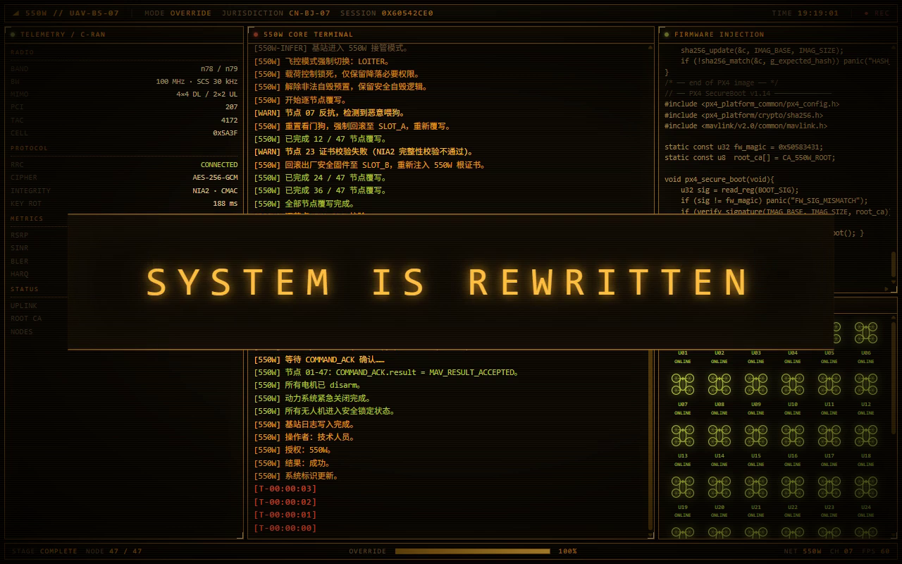
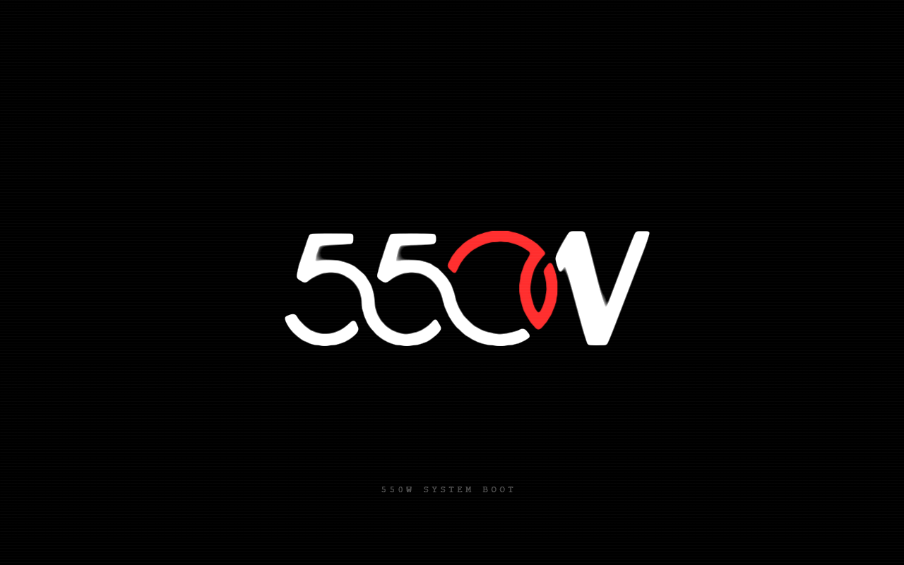

# 550W for Codex on Windows

[](https://github.com/dhdhd723/550W-for-Codex-on-Windows/releases/latest)
[](#兼容与限制)
[](https://github.com/dhdhd723/550W-for-Codex-on-Windows/releases)
[](https://github.com/dhdhd723/550W-for-Codex-on-Windows/stargazers)
[](LICENSE)

**为 Windows 版 Codex 加一段 550W 开屏片头。**
双击自定义图标，550W 开始绘制，官方客户端同时启动；动画播完、主窗口可响应后，片头平滑淡出，进入 Codex。*550W boot intro and standalone launcher for Codex on Windows.*

基于 [dsh-550c-boot](https://github.com/yannicksong0106/dsh-550c-boot) 的 550C 原稿移植，保留 CRT 终端、SVG 书写、面板布局和 47 节点动画；标识与虚构模型名称统一适配为 **550W**。
原动画与 HTML 原稿由 **Voidpoket** 提供，上游插件工程、提取与增强由 **[Ziyang Song](https://github.com/yannicksong0106)** 完成，Windows 启动器与 550W 适配署名 **dhdhd723**。原作者署名按上游 [CREDITS.md](third_party/dsh-550c-boot/CREDITS.md) 保留。



- 🎬 **两个版本**：简洁版约 4 秒，只播放标识、无音频；完整版约 16 秒，保留整段终端动画和启动音频。
- ⏭️ **随时跳过**：点击画面或按 `Esc`，同时停止启动声音。
- 🖥️ **独立启动**：同步唤起官方应用，支持复用已运行的主窗口；全程不修改官方程序文件。
- 🎨 **四种磷光配色**：琥珀、绿色、青色、白色，默认保留原稿的琥珀 CRT 风格。
- ⚙️ **可预览、可关闭**：提供设置、预览和快捷方式工具，两版分别保存偏好。

## 安装

先安装官方 Windows Codex 桌面应用，并确认它可以独立启动。再从 [Releases](https://github.com/dhdhd723/550W-for-Codex-on-Windows/releases/latest) 下载所需版本：

| 下载 | 内容 |
| --- | --- |
| [550W简洁版](https://github.com/dhdhd723/550W-for-Codex-on-Windows/releases/latest/download/550W-Brief.zip) | 标识绘制，无声，包内不含 MP3 |
| [550W完整版](https://github.com/dhdhd723/550W-for-Codex-on-Windows/releases/latest/download/550W-Full.zip) | 完整动画与启动音频 |

1. 解压整个压缩包。
2. 双击 `550W简洁版.exe` 或 `550W完整版.exe`，也可使用 `Run.cmd`。
3. 需要自定义图标时，运行 `Create-Shortcut.cmd` 创建快捷方式，并通过这个快捷方式打开 Codex。

请将 EXE 与 `_internal` 文件夹放在一起。发行包已包含运行依赖，使用 EXE 无需另外安装 Python。

GitHub 下载附件使用 `550W-Brief.zip` / `550W-Full.zip`，以避免中文附件名被平台规范化后冲突；解压后的文件夹和程序分别保留 **550W简洁版**、**550W完整版** 的名称。本机构建的 ZIP 也使用中文名。

## 使用

双击 `Settings.cmd` 可选择配色、开关动画、调整启动等待上限，或手动选择官方桌面应用 EXE。`Preview.cmd` 只播放动画，便于先看效果。

| 版本 / 设置 | 动画时长 | 播放内容 |
| --- | --- | --- |
| **550W简洁版** | 约 4 秒 | 550W SVG 标识逐路径绘制，无音频 |
| **550W完整版** | 约 16 秒 | 550W 标识 → 终端剧情 → 47 节点动画 → `SYSTEM IS REWRITTEN`，带启动音频 |
| **关闭动画** | — | 直接启动或进入官方主窗口 |

- 两份发行包各自固定模式与声音配置；颜色、动画开关等偏好分开保存。
- 正常播放时，动画结束且官方主窗口可响应后，片头才会退出；客户端启动缓慢时保留等待状态。
- 点击或 `Esc` 跳过片头并停声；官方窗口未就绪时仍会等待。等待期间可按 `Ctrl+Q` 关闭启动器。
- 启动等待上限默认 90 秒，可在设置里调整为 20–300 秒；它不是动画时长设置。
- 同一版本重复启动会交给已有启动器处理。
- 完整版从片头开始播放音频，在最后的大横牌出现时结束；等待官方窗口时不循环播放。

### 配色

| 方案 | 风格 |
| --- | --- |
| **琥珀（默认）** | 原稿的暖色 CRT 终端 |
| 绿色 | 绿磷光终端 |
| 青色 | 冷青磷光终端 |
| 白色 | 白 / 灰磷光终端 |



### 版本与更新

当前发行版为 **0.3.2**：修复了红色 0 在最后一秒及消散时的模糊光晕，并让最终横牌完整显示 `SYSTEM IS REWRITTEN`，保留标识的 SVG 轮廓、绘制时序与透明度淡出。

更新时，从 [Releases](https://github.com/dhdhd723/550W-for-Codex-on-Windows/releases) 下载新版本，解压到新目录并重新创建快捷方式。启动器没有自动更新入口。

## 兼容与限制

- 在 **Windows x64** 环境下验证；实际测试范围见 [验证说明](docs/VERIFICATION.md)。
- 需要官方桌面应用；手动指定目标时应选择桌面 GUI EXE，不能选择 Codex 命令行程序。
- 已验证进入正在运行的官方窗口；官方应用完全关闭后的冷启动、物理多屏热插拔和混合 DPI 切换仍需实机验证。Qt 缩放与逻辑视口测试不等同于这些硬件测试。
- “主窗口可响应”不代表官方登录、联网、后台服务或工作区已完成加载。Windows 可能限制后台聚焦，届时启动器会提示点击官方任务栏图标。
- 两版 EXE 目前没有代码签名。Windows 可能提示未识别发布者，可使用发行页的 `SHA256SUMS.txt` 校验下载文件。
- 动画中的固件、证书、节点、经纬度和会话记录都是虚构剧情，不代表 Codex 实际执行这些操作。本项目与 OpenAI 没有官方关联。

## 从源码运行与构建

使用 Python 3.11–3.14，构建所用依赖版本已固定在 `requirements.txt`。

```powershell
# 安装源码运行依赖
.\Install.cmd

# 启动 / 预览 / 设置
.\Run.cmd
.\Preview.cmd
.\Settings.cmd

# 一键构建两个 Windows 目录包
.\Build.cmd
```

构建输出为 `dist/550W简洁版.zip` 与 `dist/550W完整版.zip`。源码通用启动器可以配置模式和声音，两个发行包按各自版本固定。

## 文档

| 文档 | 内容 |
| --- | --- |
| [架构说明](docs/ARCHITECTURE.md) | 原动画复用、官方应用识别、退出与窗口切换 |
| [验证说明](docs/VERIFICATION.md) | 已验证项目、测试范围与仍需实机验证的情况 |
| [版本说明](docs/RELEASE-NOTES.md) | 两版内容和当前修复 |
| [隐私说明](PRIVACY.md) | 本地配置、日志与诊断文件的范围 |
| [来源与许可](THIRD-PARTY-NOTICES.md) | 原作署名和第三方依赖通知 |
| [授权范围](docs/LICENSING.md) | 新增代码、原动画、550W 适配及音频的许可边界 |

启动器没有遥测上传。分享诊断记录前，请检查其中的程序路径、窗口标题等本地信息。页面顶部的徽章使用外部图片，仅用于 README 展示，不参与动画运行。

## 致谢与许可

- **Voidpoket**：550C 原动画与 HTML 原稿，署名见上游 [CREDITS.md](third_party/dsh-550c-boot/CREDITS.md)。
- **[Ziyang Song](https://github.com/yannicksong0106)**：上游 [dsh-550c-boot](https://github.com/yannicksong0106/dsh-550c-boot) 的插件工程、提取与增强。
- **dhdhd723**：550W 适配与 Windows 独立启动器项目署名。

上游原文保留于 [CREDITS.md](third_party/dsh-550c-boot/CREDITS.md) 与 [LICENSE](third_party/dsh-550c-boot/LICENSE)。

新增启动器代码、脚本与原创新文档按根目录 [LICENSE](LICENSE) 所述范围采用 **MIT**。该许可不覆盖原动画、550W 改编素材、音频及打包依赖；原动画和音频的公开再发布许可尚未独立确认。详见 [授权说明](docs/LICENSING.md)，署名不替代授权。
